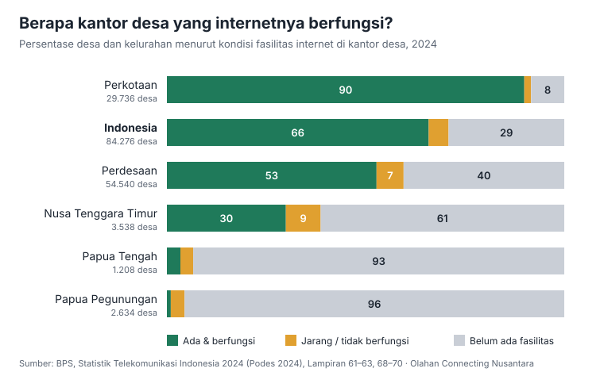

Ketika membicarakan kesenjangan digital di Indonesia, pertanyaan yang sering muncul adalah: sudahkah jaringan internet menjangkau desa-desa? Data terbaru menunjukkan bahwa sebagian besar desa sebenarnya sudah menerima sinyal seluler. Namun, ada persoalan lain yang tidak kalah penting: apakah konektivitas tersebut benar-benar bisa dimanfaatkan?

Kantor desa menjadi salah satu tempat untuk melihat kesenjangan ini. Di sinilah warga mengurus berbagai dokumen, perangkat desa menyusun laporan, dan program pemerintah dijalankan. Jika kantor desa belum memiliki akses internet yang memadai, kehadiran sinyal seluler di wilayah tersebut belum tentu cukup untuk mendukung pelayanan publik berbasis digital.

Gambaran ini terlihat dalam data Potensi Desa (Podes) 2024 yang diterbitkan BPS melalui *Statistik Telekomunikasi Indonesia 2024*. Data tersebut mencakup **84.276 desa dan kelurahan di 38 provinsi**, sehingga memungkinkan kita melihat bukan hanya jangkauan sinyal seluler, tetapi juga ketersediaan fasilitas internet di kantor desa.

## Sinyal sudah menjangkau hampir seluruh desa

Secara nasional, jangkauan sinyal seluler sebenarnya sudah cukup luas. Podes 2024 mencatat bahwa **96,3% desa dan kelurahan telah menerima sinyal telepon seluler**. Bahkan, 78,8% di antaranya mendapatkan sinyal kuat atau sangat kuat.

Meski demikian, masih ada 17,5% desa dengan sinyal lemah. Sebanyak **3.117 desa atau 3,7% bahkan belum menerima sinyal sama sekali**.

Persoalan ini tidak tersebar secara merata. Dari 3.117 desa tanpa sinyal, sebanyak 3.090 berada di wilayah perdesaan. Sebagian besar juga terkonsentrasi di kawasan timur Indonesia.

Di kelompok wilayah Maluku dan Papua, sekitar **25,1% desa masih belum terjangkau sinyal seluler**. Sebagai perbandingan, di Jawa angkanya hanya 0,02%.

Kesenjangan semakin terlihat di Papua Pegunungan dan Papua Tengah. Di kedua provinsi tersebut, masing-masing 55,4% dan 52,3% desa belum menerima sinyal seluler. Artinya, lebih dari separuh desa di kedua provinsi itu masih berada di luar jangkauan jaringan telekomunikasi.

## Ketika sinyal tersedia, tetapi kantor desa belum terhubung

Namun, jangkauan sinyal bukanlah satu-satunya ukuran konektivitas digital. Ketika perhatian dialihkan ke fasilitas internet di kantor desa, gambaran yang muncul ternyata berbeda.

Podes 2024 mencatat **59.747 kantor desa atau 70,9% telah memiliki fasilitas internet**. Dari jumlah tersebut, 92,9% fasilitas dilaporkan berfungsi.

Di sisi lain, sekitar **24.500 kantor desa (29,1%) belum memiliki fasilitas internet**. Dengan kata lain, hampir tiga dari sepuluh kantor desa belum dilengkapi fasilitas yang memungkinkan perangkat desa mengakses internet untuk mendukung pekerjaan dan pelayanan kepada masyarakat.

Temuan ini memperlihatkan satu persoalan penting: desa yang sudah berada dalam jangkauan sinyal belum tentu memiliki konektivitas yang dapat digunakan secara langsung. Ketersediaan jaringan dan kesiapan fasilitas di tingkat lokal merupakan dua hal yang berbeda.

## Fasilitas Ada, tetapi Belum Tentu Berfungsi

Persoalannya ternyata tidak berhenti pada ada atau tidaknya fasilitas internet. Di wilayah perdesaan, **3.713 kantor desa atau 11,4% dari kantor desa yang memiliki fasilitas internet melaporkan bahwa koneksinya jarang berfungsi atau tidak berfungsi sama sekali**. Di wilayah perkotaan, proporsinya jauh lebih rendah, yakni 1,9%.

Artinya, memiliki fasilitas internet belum tentu menjamin konektivitas yang dapat diandalkan. Infrastruktur yang sudah dibangun tetap membutuhkan pemeliharaan agar bisa digunakan secara berkelanjutan.

## Papua menghadapi kesenjangan yang berlapis

Perbedaan antarprovinsi memperlihatkan bahwa persoalan konektivitas tidak hanya berkaitan dengan jangkauan jaringan. Di sejumlah wilayah, keterbatasan sinyal terjadi bersamaan dengan minimnya fasilitas internet di kantor desa.

Di **Papua Pegunungan**, misalnya, dari 2.634 desa dan kelurahan, hanya 117 kantor desa yang memiliki fasilitas internet. Lebih jauh lagi, hanya sekitar 26 di antaranya yang memiliki fasilitas yang berfungsi. Dengan demikian, kurang dari 1% desa dan kelurahan di provinsi ini memiliki fasilitas internet kantor desa yang dapat digunakan.

Kondisi di **Papua Tengah** juga memprihatinkan. Dari 1.208 desa dan kelurahan, hanya 80 kantor desa yang memiliki fasilitas internet, dan sekitar separuhnya dilaporkan berfungsi.

Namun, persoalan yang berbeda terlihat di **Nusa Tenggara Timur (NTT)**. Hampir seluruh desa di provinsi ini telah menerima sinyal seluler; hanya 0,6% yang belum terjangkau. Meski demikian, **61% kantor desa belum memiliki fasilitas internet**.

Kondisi NTT menunjukkan bahwa memperluas jangkauan jaringan saja tidak otomatis membuat kantor desa terkoneksi. Ketersediaan perangkat, biaya berlangganan, pasokan listrik, serta kemampuan untuk mengoperasikan dan merawat fasilitas internet juga menentukan apakah konektivitas dapat dimanfaatkan.

Sebaliknya, DI Yogyakarta, Jawa Tengah, Bali, dan DKI Jakarta melaporkan bahwa hampir seluruh kantor desanya telah memiliki fasilitas internet. Perbedaan ini memperlihatkan betapa tidak meratanya kesiapan konektivitas digital antardaerah.

## Konektivitas desa bukan sekadar urusan infrastruktur

Mengapa kondisi kantor desa perlu mendapat perhatian? Karena kantor desa merupakan salah satu titik terdekat antara masyarakat dan pemerintah. Berbagai urusan administrasi, pelaporan, hingga penyampaian informasi program pemerintah berlangsung di tempat ini.

Ketika layanan publik semakin bergantung pada sistem daring, kantor desa tanpa koneksi internet yang berfungsi berisiko menghadapi hambatan dalam menjalankan tugasnya. Perangkat desa mungkin harus mencari akses internet di tempat lain, sementara masyarakat dapat menghadapi proses pelayanan yang lebih lambat.

Temuan Podes 2024 memperlihatkan bahwa kesenjangan digital di Indonesia memiliki beberapa lapisan. Persoalan pertama adalah **jangkauan jaringan**: apakah sinyal sudah mencapai suatu wilayah? Persoalan kedua adalah **ketersediaan fasilitas**: apakah kantor desa memiliki sarana untuk mengakses internet? Persoalan ketiga adalah **keberfungsian**: apakah fasilitas tersebut benar-benar dapat digunakan?

Ketiganya tidak bisa diperlakukan sebagai persoalan yang sama. Wilayah yang sudah terjangkau sinyal masih mungkin tertinggal dalam penyediaan fasilitas, sementara fasilitas yang sudah tersedia belum tentu berfungsi secara konsisten.

Karena itu, upaya pemerataan digital tidak cukup berhenti pada pembangunan menara BTS dan perluasan cakupan jaringan. Pemerintah juga perlu memastikan bahwa kantor desa memiliki fasilitas internet yang memadai, biaya operasional yang berkelanjutan, serta dukungan teknis untuk pemeliharaannya.

Pada akhirnya, ukuran keberhasilan pemerataan digital bukan hanya berapa banyak desa yang sudah menerima sinyal, melainkan berapa banyak desa yang benar-benar dapat memanfaatkan internet untuk meningkatkan pelayanan kepada masyarakat.

## Catatan tentang data

- Data bersumber dari Potensi Desa (Podes) 2024 yang diterbitkan BPS dalam *Statistik Telekomunikasi Indonesia 2024*. Kondisi fasilitas internet (berfungsi, jarang berfungsi, atau tidak berfungsi) merupakan kondisi yang dilaporkan pada saat pendataan, bukan hasil pengukuran kecepatan internet.
- Istilah "desa" dalam artikel ini mencakup desa dan kelurahan sesuai cakupan Podes.
- Data per provinsi dan wilayah dapat ditelusuri melalui [Data Explorer](https://www.connectingnusantara.com/explorer/) dan [Katalog Data](https://www.connectingnusantara.com/katalog/) Nusantara Data 2.0, khususnya dataset Lampiran 61–63 dan 67–70 dalam *Statistik Telekomunikasi Indonesia 2024*.
