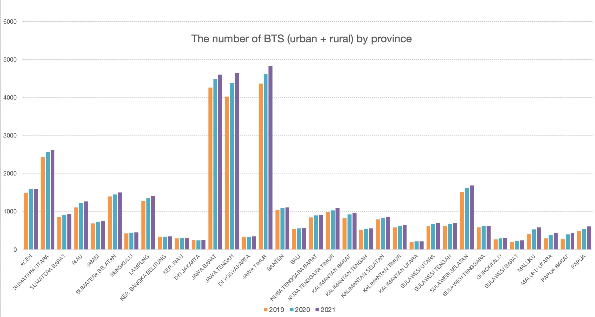

Indonesia, as an archipelagic nation of thousands of islands spanning a vast area, faces significant geographical challenges when providing broadband access to its population. These challenges contribute to the country's digital divide and hinder efforts to connect remote and underserved areas.

Most Indonesians rely on mobile subscriptions from telecommunication providers rather than broadband connections. This is not without a reason. Like other developing countries, building and maintaining wired broadband infrastructure, such as fiber-optic networks, is costly. Developing countries often have limited resources and budget constraints, making investing in extensive fixed-line broadband infrastructure challenging. Mobile networks, on the other hand, can be deployed more cost-effectively, especially in densely populated urban areas.

BTS or Base Transceiver Station infrastructure, is a fundamental mobile network component that connects mobile devices to the core network infrastructure. It facilitates wireless communication by transmitting and receiving radio signals, allowing users to make calls, send messages, and access data services while moving. The strategic placement of BTS units and the process of handovers ensure that mobile connectivity remains consistent and reliable in the network's covered area.

However, BTS infrastructure for mobile telecommunications in Indonesia also presents several geographical challenges due to the country's vast and diverse landscape. These challenges affect the expansion and maintenance of mobile networks across the archipelago. The challenges can be understood based on the following figure, which presents the disparity of BTS among provinces in Indonesia.

### Java Island remained the dominant

The chart shows the number of BTS in 34 provinces in Indonesia from 2019 to 2021. In 2021, the provinces with the highest number of BTS were East Java (Jawa Timur), Central Java (Jawa Tengah), and West Java (Jawa Barat), with numbers of 4826, 4642, and 4601 respectively. These three provinces are located on Java island--the main island where the infrastructure and transportation are mostly well equipped. The three provinces are also Indonesia's biggest and most populous.
